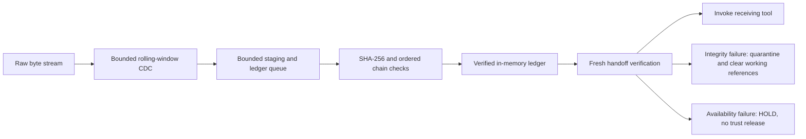
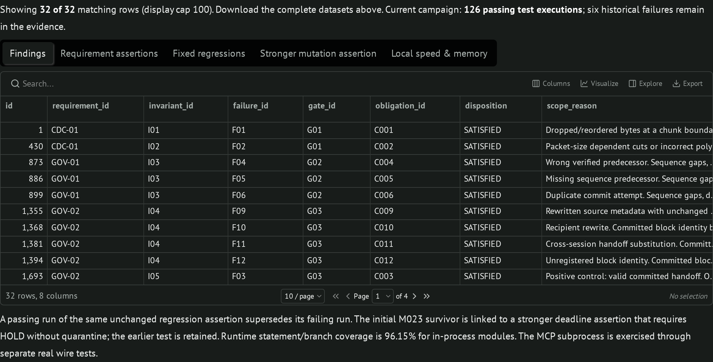

# HMT Streaming Governance

[](https://github.com/CollaborativeMinD/HMT-Streaming-Governance/actions/workflows/ci.yml)
[](.github/workflows/ci.yml)
[](VV_report.md)
[](vv_evidence/mutation_results.json)
[](vv_evidence/dataframes/cross_report.csv)
[](governance.sysml)
[](governance_mcp.py)

**Trace streamed agent data into a bounded integrity ledger, then verify the handoff before a tool receives it.**

**Durable successor profile:** PostgreSQL ledger and inbox, encrypted Redis acceleration, authenticated native Tailcat handoffs, a separate Headscale management mesh, and OpenBao transit keys. [Build and run](service/README.md) · [Current V&V evidence](service/evidence/REPORT.md) · [Private deployment/recovery](deployment/README.md) · [Durable SysML v2](service/model/durable-governance.sysml).

[](service/README.md)
[](service/evidence/cross/summary.json)
[](service/evidence/mutations/summary.json)

These are scoped evidence badges. The durable lane participates in CI Admission; deployment to an on-premises host still requires the recorded network, bootstrap and rollback-anchor qualifications. Rapid one-shot reconnect remains an availability HOLD; persistent native sessions pass the isolated-container handoff flow. No lab credentials are included. The badges above this paragraph describe the original reference campaign.

## Notebook and in-memory reference

A byte-preserving content-defined chunker feeds an asynchronous SHA-256 worker. The reference ledger binds payload identity, sequence, predecessor and routing metadata, while the marimo notebook makes verification, quarantine and HOLD inspectable. The root runtime remains an **in-memory engineering reference**: restart loses its ledger, and hash consistency alone establishes neither authenticated identity nor exactly-once execution.

[Run the notebook](#run-locally) · [Reference runtime contract](docs/runtime-contract.md) · [Reference V&V report](VV_report.md) · [CI/CD runbook](docs/ci-cd.md) · [Reference functional model](governance.sysml)

## Lifecycle



CDC uses base-256 polynomial hashing over a prime field: Rabin–Karp style, not a GF(2) Rabin fingerprint. It selects boundaries and provides no integrity assurance. Immutable byte chunks preserve arbitrary UTF-8 packetization; payload and block hashes have distinct meanings. [Exact algorithms, hash material and resource bounds](docs/runtime-contract.md#cdc-contract).

## Run locally

Requires [uv](https://docs.astral.sh/uv/). Clone the repository, then open the notebook (Python 3.13+ for its supplied environment):

```bash
git clone https://github.com/CollaborativeMinD/HMT-Streaming-Governance.git
cd HMT-Streaming-Governance
uvx marimo@0.25.1 edit --sandbox governance_lab.py
```

Change the stream, window/packet sizes or tampering scenario. Inspect carved bytes, receipt state, verified calls, ledger links and the first rejection. The notebook includes nine scenarios, SQL findings and an embedded source/evidence download. [HTML snapshot](governance_lab.html).


*Recorded notebook view, not a live CI dashboard. Current runs publish their own evidence artifacts.*

The reusable engine uses only the Python standard library and supports Python 3.11+. For the locked MCP stdio adapter:

```bash
uv run --locked governance_mcp.py
```

This starts a local stdio process, not an HTTP service. [Host configuration and five tool contracts](docs/runtime-contract.md#mcp-server) · [Agent instruction template](agent_hooks.md).

## Verification and evidence

```bash
uv run --locked run_vv.py
uv run --locked sql_dataframes.py
python -m unittest ci.test_delivery -v
```

The runtime campaign executes **60 unit/API/model/evidence checks plus 33 pytest and 33 unittest Cartesian checks: 126 executions**. It includes negative, boundary, mutation, integration, behavioral, API, structural/semantic complexity, speed, memory and real MCP subprocess E2E witnesses. **26 selected semantic mutants** are killed by assertions. Seven additional delivery-gate tests challenge missing/skipped/failed evidence, stale source, surviving/invalid mutants, duplicate kills and changed/unlisted archive bytes.

SQL materializes **18 invariants × 32 challenges × 13 gates = 7,488 tuples**. **32 applicable contracts** require both frameworks to pass; **7,456 OUT_OF_SCOPE rows** retain explicit reasons and both catalog-audit links. Scope audits are not behavioral passes. These are finite declared scenarios, not all real-world inputs, interleavings or simultaneous faults.

[Requirement/assertion evidence](vv_evidence/dataframes/requirement_evidence.csv) · [Every finding and its links](vv_evidence/dataframes/finding_evidence.csv) · [Six preserved failures and satisfying tests](vv_evidence/dataframes/supersessions.csv) · [Mutation supersession](vv_evidence/dataframes/mutation_supersessions.csv) · [SQLite](vv_evidence/assurance.sqlite) · [Replayable SQL](vv_evidence/assurance.sql).

The [functional SysML v2 model](governance.sysml) has typed interfaces, guarded action flow, lifecycle states, connected parts and requirement mappings. Strict parser validation and 256 Boolean gate vectors plus integer boundary oracles are separate witnesses. Model agreement does not prove implementation equivalence. Local timing and traced-memory ceilings are regression observations, not service SLAs or RSS measurements.

## CI/CD

PRs and `main` run the full locked campaign on **Python 3.11, 3.12 and 3.13**, strict model validation, notebook execution/export, dependency/secret scans, and workflow syntax checks. Admission rejects failed, canceled or skipped lanes. A source/evidence archive is then hashed, extracted into a new directory and replayed before it becomes a delivery artifact.

Version tags (`v*`) rerun those gates and publish the **same verified ZIP and checksum** to GitHub Releases. Default tokens are read-only; only tag delivery receives repository-content write permission. Actions and executable tools are pinned. No service is activated and no MCP host is registered. [Lane design, artifacts, reproduction and release procedure](docs/ci-cd.md).

## Authority and deployment boundary

A pending receipt grants no ingestion authority. Full handoff verification binds committed content and metadata to the expected session and receiver. Mismatches stop the affected call and quarantine; verifier/worker/resource failures HOLD. Missing acknowledgements do not justify retrying an external effect.

The public record view prevents accidental API mutation; it is not independently trusted storage. Production composition still needs authenticated writers, durable append-only storage, signed or externally checkpointed roots, a real execution gateway and side-effect idempotency. Clearing a Python reference list cannot erase an LLM's previously consumed context. [Full boundaries](docs/runtime-contract.md#deployment-boundary).

The [import provenance](provenance/import.json) identifies the supplied archive and exact import commit. Its source/evidence history remains available; publication adds repository documentation, a fixed certificate-store dependency lock and executable delivery gates. No project-level license is declared by this import.
