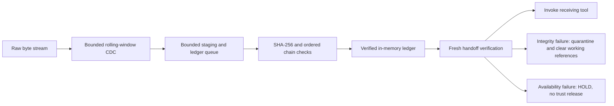

# HMT Streaming Governance

[](https://github.com/CollaborativeMinD/HMT-Streaming-Governance/actions/workflows/ci.yml?query=branch%3Amain)
[](.github/workflows/ci.yml)
[](VV_report.md)
[](vv_evidence/mutation_results.json)
[](vv_evidence/dataframes/cross_report.csv)
[](governance.sysml)
[](governance_mcp.py)

**Trace streamed agent data into a bounded integrity ledger, then verify the handoff before a tool receives it.**

Two implementation profiles are available. The default branch contains the notebook and in-memory reference. The durable PostgreSQL/Tailcat uplift is retained on [`codex/durable-tailcat-control`](https://github.com/CollaborativeMinD/HMT-Streaming-Governance/tree/codex/durable-tailcat-control), with source, qualification evidence, and deployment guidance.

| Profile | Location | Implemented boundary | Evidence scope |
|---|---|---|---|
| Notebook / reference | `main`, repository root | Byte-preserving CDC, bounded asynchronous SHA-256 ledger, local MCP verification and quarantine | 126 executions, 26 selected mutants, 7,488 SQL combinations |
| Durable uplift | Retained branch, `service/` and `tailcat-gateway/` | PostgreSQL custody, encrypted Redis cache, authenticated Tailcat messaging, separate Headscale management mesh, OpenBao transit and fixed effect adapters | 86 pytest + 29 unittest executions, 10 selected mutants, 9,216 SQL combinations; four HOLD obligations |

[PR #2](https://github.com/CollaborativeMinD/HMT-Streaming-Governance/pull/2) was closed **without merging**, preserving the uplift as a visible evidence record. [PR #3](https://github.com/CollaborativeMinD/HMT-Streaming-Governance/pull/3) merged its CI corrections into that retained branch at [`cee49bb`](https://github.com/CollaborativeMinD/HMT-Streaming-Governance/commit/cee49bbe3d728dc5ea7a8fbb1f646bbd4d1a21a3). These runtime and workflow changes are not part of `main`.

[Run the notebook](#run-locally) · [Durable profile](#durable-uplift-and-retained-evidence) · [Reference runtime contract](docs/runtime-contract.md) · [Reference V&V report](VV_report.md) · [CI/CD runbook](docs/ci-cd.md) · [Reference functional model](governance.sysml)

The main CI badge is live. The other badges above describe the reference evidence snapshot. Counts for each profile remain separate; executed checks and selected faults are scoped witnesses, not certifications or exhaustive coverage. Each successor commit needs its own qualification.

## Durable uplift and retained evidence

[](https://github.com/CollaborativeMinD/HMT-Streaming-Governance/tree/codex/durable-tailcat-control)
[](https://github.com/CollaborativeMinD/HMT-Streaming-Governance/blob/cee49bbe3d728dc5ea7a8fbb1f646bbd4d1a21a3/service/evidence/REPORT.md)
[](https://github.com/CollaborativeMinD/HMT-Streaming-Governance/blob/cee49bbe3d728dc5ea7a8fbb1f646bbd4d1a21a3/service/evidence/mutations/summary.json)
[](https://github.com/CollaborativeMinD/HMT-Streaming-Governance/tree/cee49bbe3d728dc5ea7a8fbb1f646bbd4d1a21a3/service/evidence/cross)
[](https://github.com/CollaborativeMinD/HMT-Streaming-Governance/blob/cee49bbe3d728dc5ea7a8fbb1f646bbd4d1a21a3/service/evidence/REPORT.md)

PostgreSQL owns the durable inbox, immutable ledger, session heads, custody events and effect claims. Redis holds short-lived AES-GCM ciphertext and never grants authority. Native Tailcat derives peer identity from the authenticated transport; fresh PostgreSQL checks enforce identity, role, route, epoch, expiry and session state. Headscale controls a separate management network. OpenBao supplies transit signing and cache data keys. Fixed mTLS adapters record one-shot effect claims and reconcile ambiguous outcomes without automatically redispatching them.

The [qualified CI run](https://github.com/CollaborativeMinD/HMT-Streaming-Governance/actions/runs/39865904247) passed all eight qualification checks, including clean-archive replay and Release eligibility. Its source head was `6eef69c`; the subsequent squash merge retained the same reviewed file tree at `cee49bb`. Tag publishing was correctly skipped on that PR. The finite durable catalog contains **32 requirements × 32 failure modes × 9 gates = 9,216 rows**: 28 executable requirements satisfied locally, four HOLD obligations, and 9,184 explicitly OUT_OF_SCOPE combinations. Separate pytest and unittest suites link applicable findings to behavioral assertions and retained supersessions.

Four obligations remain open:

- An independent monotonic checkpoint anchor against hostile database-owner rollback.
- Target on-premises WAN/NAT, partition, reboot and fencing qualification.
- Production PKI, workload-token enrollment and renewal, and multi-share key bootstrap.
- Reliable rapid one-shot Tailcat reconnection; persistent native sessions passed the isolated-container workflow.

[Build and replay](https://github.com/CollaborativeMinD/HMT-Streaming-Governance/blob/cee49bbe3d728dc5ea7a8fbb1f646bbd4d1a21a3/service/README.md) · [Qualification report](https://github.com/CollaborativeMinD/HMT-Streaming-Governance/blob/cee49bbe3d728dc5ea7a8fbb1f646bbd4d1a21a3/service/evidence/REPORT.md) · [SQL/DF findings and supersessions](https://github.com/CollaborativeMinD/HMT-Streaming-Governance/tree/cee49bbe3d728dc5ea7a8fbb1f646bbd4d1a21a3/service/evidence/cross) · [Durable SysML v2](https://github.com/CollaborativeMinD/HMT-Streaming-Governance/blob/cee49bbe3d728dc5ea7a8fbb1f646bbd4d1a21a3/service/model/durable-governance.sysml) · [Deployment and recovery](https://github.com/CollaborativeMinD/HMT-Streaming-Governance/blob/cee49bbe3d728dc5ea7a8fbb1f646bbd4d1a21a3/deployment/README.md)

To inspect that exact uplift snapshot after cloning, check out `cee49bbe3d728dc5ea7a8fbb1f646bbd4d1a21a3` and follow its service runbook. Its lab requires Linux, Docker, uv, Node and the pinned Go toolchain; the lab creates disposable services and test credentials. Local qualification is not on-premises activation or a production readiness claim.

## Reference lifecycle

A byte-preserving content-defined chunker feeds an asynchronous SHA-256 worker. The reference ledger binds payload identity, session sequence, predecessor and routing metadata; its gateway distinguishes verified delivery, integrity quarantine and availability HOLD. Restart loses this profile's in-memory ledger. Hash consistency alone establishes neither authenticated identity nor exactly-once execution.



CDC uses base-256 polynomial hashing over a prime field: Rabin–Karp style, not a GF(2) Rabin fingerprint. It selects boundaries and provides no integrity assurance. Immutable byte chunks preserve arbitrary UTF-8 packetization; payload and block hashes have distinct meanings. [Exact algorithms, hash material and resource bounds](docs/runtime-contract.md#cdc-contract).

## Run locally

Requires [uv](https://docs.astral.sh/uv/). Clone the repository, then open the notebook (Python 3.13+ for its supplied environment):

```bash
git clone https://github.com/CollaborativeMinD/HMT-Streaming-Governance.git
cd HMT-Streaming-Governance
uvx marimo@0.25.1 edit --sandbox governance_lab.py
```

Change the stream, window/packet sizes or tampering scenario. Inspect carved bytes, receipt state, verified calls, ledger links and the first rejection. The notebook includes nine scenarios, SQL findings and an embedded source/evidence download. [HTML snapshot](governance_lab.html).


*Recorded notebook view, not a live CI dashboard. Current runs publish their own evidence artifacts.*

The reusable engine uses only the Python standard library and supports Python 3.11+. For the locked MCP stdio adapter:

```bash
uv run --locked governance_mcp.py
```

This starts a local stdio process, not an HTTP service. [Host configuration and five tool contracts](docs/runtime-contract.md#mcp-server) · [Agent instruction template](agent_hooks.md).

## Reference verification and evidence

```bash
uv run --locked run_vv.py
uv run --locked sql_dataframes.py
python -m unittest ci.test_delivery -v
```

The runtime campaign executes **60 unit/API/model/evidence checks plus 33 pytest and 33 unittest Cartesian checks: 126 executions**. It includes negative, boundary, mutation, integration, behavioral, API, structural/semantic complexity, speed, memory and real MCP subprocess E2E witnesses. **26 selected semantic mutants** are killed by assertions. Seven additional delivery-gate tests challenge missing/skipped/failed evidence, stale source, surviving/invalid mutants, duplicate kills and changed/unlisted archive bytes.

SQL materializes **18 invariants × 32 challenges × 13 gates = 7,488 tuples**. **32 applicable contracts** require both frameworks to pass; **7,456 OUT_OF_SCOPE rows** retain explicit reasons and both catalog-audit links. Scope audits are not behavioral passes. These are finite declared scenarios, not all real-world inputs, interleavings or simultaneous faults.

[Requirement/assertion evidence](vv_evidence/dataframes/requirement_evidence.csv) · [Every finding and its links](vv_evidence/dataframes/finding_evidence.csv) · [Six preserved failures and satisfying tests](vv_evidence/dataframes/supersessions.csv) · [Mutation supersession](vv_evidence/dataframes/mutation_supersessions.csv) · [SQLite](vv_evidence/assurance.sqlite) · [Replayable SQL](vv_evidence/assurance.sql).

The [functional SysML v2 model](governance.sysml) has typed interfaces, guarded action flow, lifecycle states, connected parts and requirement mappings. Strict parser validation and 256 Boolean gate vectors plus integer boundary oracles are separate witnesses. Model agreement does not prove implementation equivalence. Local timing and traced-memory ceilings are regression observations, not service SLAs or RSS measurements.

## CI/CD

The **default-branch lane** qualifies PRs targeting `main`, pushes to `main`, and version tags. It runs the reference campaign on **Python 3.11, 3.12 and 3.13**, strict model validation, notebook execution/export, dependency/secret scans, and workflow syntax checks. Admission rejects failed, canceled or skipped lanes. A source/evidence archive is then hashed, extracted into a new directory and replayed before it becomes a delivery artifact.

Version tags (`v*`) rerun those gates and publish the **same verified ZIP and checksum** to GitHub Releases. Default tokens are read-only; only tag delivery receives repository-content write permission. Actions and executable tools are pinned. No service is activated and no MCP host is registered. [Lane design, artifacts, reproduction and release procedure](docs/ci-cd.md).

The **retained uplift lane** adds durable qualification to Admission, replays both profiles from the verified archive, and accepts PRs targeting the uplift branch as well as `main`. **Release eligibility** means verified packaging succeeded; **Publish Tagged GitHub Release** is a separate tag-only result. A publishing skip is expected on PRs. Neither status substitutes for the repository's independent CodeQL and Code Quality requirements. These CI corrections live on the retained branch; this README update does not install that workflow on `main`.

## Authority and deployment boundary

A pending receipt grants no ingestion authority. Full handoff verification binds committed content and metadata to the expected session and receiver. Mismatches stop the affected call and quarantine; verifier/worker/resource failures HOLD. Missing acknowledgements do not justify retrying an external effect.

For the in-memory reference, the public record view prevents accidental API mutation; it is not independently trusted storage. Deploying that profile still requires authenticated writers, durable custody, independently anchored roots, a real execution gateway and side-effect reconciliation. The retained durable profile implements several of these boundaries, with its trusted host/operator assumptions and four HOLD obligations documented above. Hashes do not establish truth, signatures alone do not identify the newest checkpoint, and an authorization check cannot undo an external effect that already started. Clearing a Python reference list cannot erase an LLM's previously consumed context. [Reference boundaries](docs/runtime-contract.md#deployment-boundary).

The [import provenance](provenance/import.json) identifies the supplied archive and exact import commit. Its source/evidence history remains available; publication adds repository documentation, a fixed certificate-store dependency lock and executable delivery gates. No project-level license is declared by this import.
