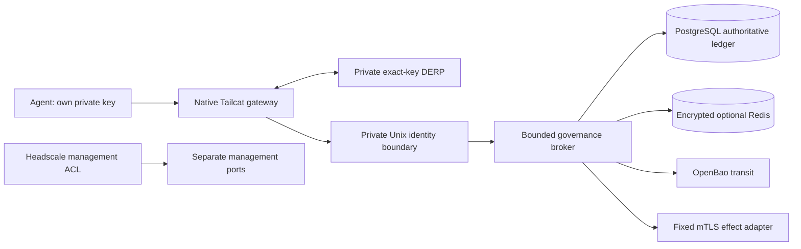

# Durable streaming governance v0.2

   

A durable successor profile for the notebook's verification boundary. PostgreSQL commits inbox receipts, immutable records, chain heads and custody events atomically. Redis stores short-lived AES-GCM ciphertext and cannot authorize anything. Every admission, handoff and effect refreshes current PostgreSQL identity, role, route, epoch, expiry and session state.

Tailcat supplies the authenticated WireGuard node key. A host-owned Go bridge derives that key from `PeerEnv`; message fields cannot replace it. A private Unix socket connects the bridge to the Python broker. Headscale supplies a separate self-hosted management mesh with explicit agent/admin port rules. OpenBao supplies transit signing and ephemeral cache data keys. Neither Headscale enrollment nor a hash by itself establishes an agent's application authorization.



`PENDING` is a durable acknowledgement, not verification. Only `VERIFIED` envelopes can pass receiver verification. Integrity violations quarantine a session; unavailable authority produces HOLD. Record/session capacities do not evict trusted history. Workers select oldest pending work per session with `FOR UPDATE SKIP LOCKED`; accepted work survives process loss. PostgreSQL trigger checks independently recompute version-one SHA-256 payload and block identities, including Unicode framing. The in-memory CDC/notebook profile remains available at the repository root; it does not silently acquire persistence by importing this service.

An effect first commits a unique per-record intent and a one-shot dispatch claim. Only a host-registered adapter can perform it. An ambiguous acknowledgement stays `UNKNOWN` or `DISPATCHING` across restart; read-only reconciliation may settle it. A changed request key cannot authorize another dispatch. This is a conservative reconciliation protocol, not an exactly-once promise for arbitrary external services.

## Replay

Requires Linux, Docker, uv, Node 20+, and the Go version in `tailcat-gateway/go.mod`. These commands create only a named disposable lab on three internal Docker networks; generated credentials stay under ignored `.lab/`.

```bash
uv sync --locked --project service
npm ci --ignore-scripts
npm run check:durable-model
go -C tailcat-gateway test ./...
CGO_ENABLED=0 go -C tailcat-gateway build -trimpath -o /tmp/hmt-tailcat-bridge .
uv run --locked --project service python service/lab.py start
uv run --locked --project service python service/headscale_lab.py
HMT_BRIDGE=/tmp/hmt-tailcat-bridge uv run --locked --project service python service/run_vv.py
uv run --locked --project service python service/lab.py stop
```

The lab uses PostgreSQL, Redis, OpenBao and Headscale images pinned by digest, verified TLS, distinct service-key mounts, a restricted SQL broker role, an exact-namespace Redis ACL, and a restricted OpenBao transit policy. Native Tailcat relay/gateway/agents run in separate nonroot, read-only containers without capabilities or a Docker socket. The fixture deliberately performs a PostgreSQL process kill, OpenBao seal and identity revocations; never point it at an existing deployment. `lab.py stop` removes only its recorded/prefixed resources. On a nonstandard Docker socket or rootless daemon, adapt the lab's explicit local Docker endpoint before qualification.

[Qualification report](evidence/REPORT.md) · [Source manifest](evidence/source-manifest.json) · [Functional SysML v2](model/durable-governance.sysml) · [SQL/DF catalog and results](evidence/cross/) · [Deployment and recovery](../deployment/README.md) · [Reference provenance](PROVENANCE.md).

The new finite catalog has 32 derived requirements, 32 failure modes and nine gates: **9,216 CROSS JOIN rows**. Both pytest and unittest execute all 28 applicable local behavioral obligations. Four deployment/availability obligations remain HOLD; 9,184 combinations retain explicit OUT_OF_SCOPE reasons. These counts do not describe all possible real-world failures or simultaneous interleavings. Ten selected Python mutants are executed with a passing control; preserved initial failures and supersession reasons remain inspectable.

The source-bound report gives exact current test counts and timing. Scope includes unit, negative, boundary, API, behavioral, integration, real mTLS/Tailcat/Headscale E2E, semantic/structural complexity, speed and traced Python memory. Strict SysML parsing is accompanied by 128 release vectors and all 25 effect-state pairs checked against live PostgreSQL triggers. Local performance is measured with the cost of durable custody and fresh authorization included; it is not compared as a speedup over memory.

## Operational contract

RPC operations are `peer_check`, `commit`, `status`, `head`, `verify`, `prepare`, `dispatch`, and `reconcile`; no agent-facing authority mutation, outcome fabrication, shell or URL-selection method exists. Frames preserve the version-one six-field transaction plus optional expected payload hash. Commit also requires a stable `request_key`. Verification requires the registered envelope `{transaction,payload_hash,ledger_hash}`; a caller-provided bare digest cannot establish registration or recipient authorization. `client.Client` offers a host-configured persistent native session and the two governance hook helpers. Do not retry an uncertain commit/effect automatically: query its receipt or reconcile its effect.

The Unix socket writer, host registry operator, database owner, adapter configuration and container host remain trusted. Runtime SQL roles cannot rewrite records, but a malicious database owner can alter physical snapshots; independent monotonic anchoring remains HOLD. Signatures support independent checkpoint verification without claiming which checkpoint is newest. The OpenBao startup DEK remains in broker memory until shutdown; issuer revocation does not retroactively erase it. Python cannot promise secure memory erasure.

Four explicit HOLDs remain: hostile-owner rollback anchoring; target WAN/NAT/partition/reboot qualification; production PKI/workload-token/multi-share bootstrap; and rapid repeated one-shot Tailcat client reconnection. Persistent sessions pass the native container workflow. Failed reconnect evidence is retained and is not relabeled as fixed by that different workflow. The fixture uses short-lived keys and a disposable 1-of-1 unseal solely for automated testing. Production must use the separate operator runbook.

Authorization is refreshed at the final pre-dispatch database check. Revocation cannot undo an external effect that has already started, and the database transaction cannot atomically include an arbitrary remote service. Transport supervision uses a one-second cycle budget and 500 ms per-probe deadline, followed by whole-listener HOLD on failure or budget expiry; this is a bounded watchdog, not a hard real-time guarantee. Operators must restart a held gateway with a fresh private endpoint file after resolving authority. The gateway refuses to overwrite an existing endpoint.

The native one-shot helper has a 12-second process lifetime ceiling, including upstream cleanup; exceeding it returns HOLD. Persistent session callers have bounded request/close deadlines in `client.Client`. This prevents an upstream cleanup stall from holding the caller indefinitely and does not remove the separate one-shot reconnect availability HOLD.
